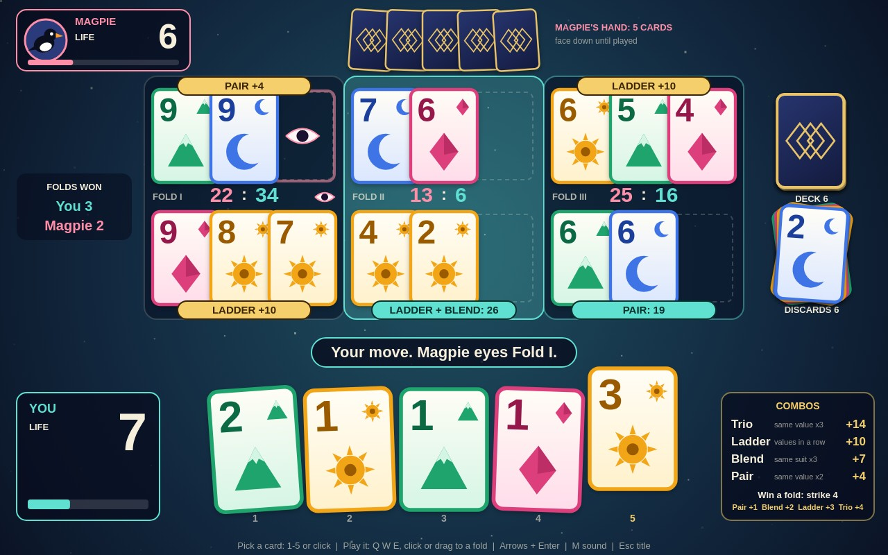
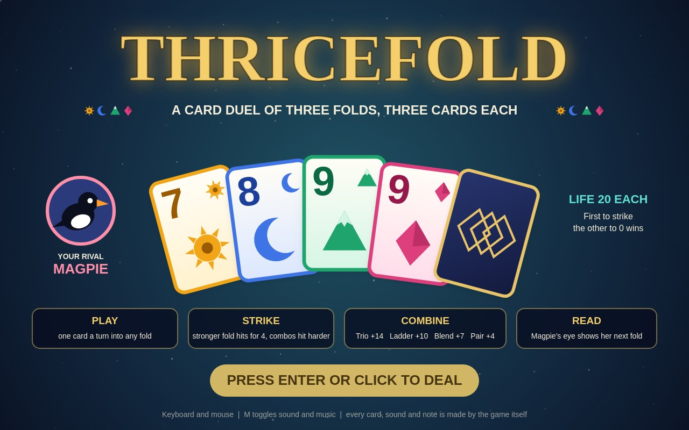
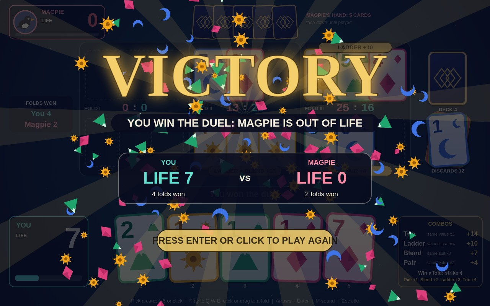
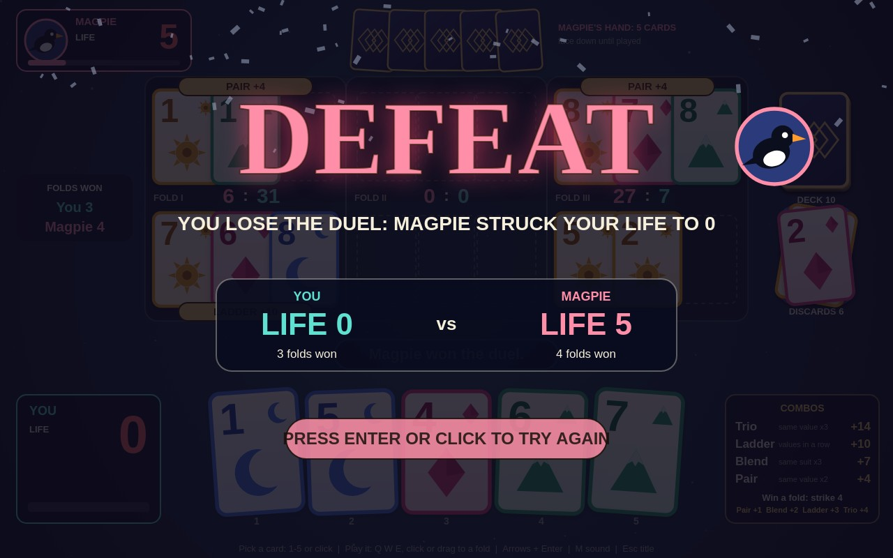

# thricefold-card-duel

[](https://make.fun/bounty/best-card-game-20261122-1826?utm_source=github&utm_medium=readme&utm_campaign=best-card-game-20261122-1826)
[](https://make.fun/bounty/best-card-game-20261122-1826/leaderboard?utm_source=github&utm_medium=readme&utm_campaign=best-card-game-20261122-1826)
[](https://make.fun/bounty/best-card-game-20261122-1826?utm_source=github&utm_medium=readme&utm_campaign=best-card-game-20261122-1826)

**Thricefold** is an original card duel for desktop browsers: three folds on the table, three cards a side in each, and one rival, Magpie, whose next move you can read.



- **Each turn is a decision.** You hold five cards and play one into any of the three folds. When both sides of a fold hold three cards, the stronger side strikes the other duellist's life (20 each). Do you feed a fold you are winning, or dump a low card into one you have already lost?
- **Cards combine in more than one way.** A fold's strength is the sum of its cards plus its combos: Pair +4, Blend (one suit) +7, Ladder (three in a row) +10, Trio +14, and a Ladder that is also a Blend scores both. A winning combo also strikes harder.
- **A rival you can read and counter.** Magpie's eye marks the fold she will play into next, before you move. Her cards lie face up once played, and the table shows both strengths of every fold.
- **Feel.** Hands are dealt card by card, cards slide, flip and snap into place, the table shakes when a fold is struck, and a win ends in a fountain of suit-shaped confetti and a fanfare.
- **Look.** Four suits, each with its own colour and its own shape: a gold Sun (circle), a blue Moon (crescent), a green Peak (triangle) and a rose Gem (diamond). Every card, the table, the sounds and the music are made by the game's own code: it ships no image and no sound file, and makes no network request.

Keyboard: `1`-`5` pick a card, `Q` `W` `E` play it into fold I, II or III (or the arrow keys and `Enter`), `M` mutes, `Esc` goes back. Mouse: click a card and then a fold, or drag the card onto the fold.

| Title | Win | Loss |
| --- | --- | --- |
|  |  |  |

## How the code is laid out

| File | Its one job |
| --- | --- |
| `game/src/card-deck.js` | the four suits and the 36-card deck |
| `game/src/lane-scoring.js` | a fold's strength and its combos |
| `game/src/duel-rules.js` | the rules of a duel as pure steps |
| `game/src/opponent-ai.js` | how Magpie rates plays and announces her fold |
| `game/src/duel-flow.js` | the duel in time: deal, play, verdict, strike, end |
| `game/src/card-motion.js` | cards that slide, flip and snap |
| `game/src/draw-card-face.js`, `draw-table.js`, `draw-screens.js` | drawing the cards, the table, and the title, win and loss screens |
| `game/src/win-flourish.js`, `sound-effects.js` | the confetti and the synthesised sounds and music |
| `game/src/player-input.js` | keyboard and mouse |
| `game/src/autopilot-duel.js`, `screenshot-scenes.js` | stand-in players and the still scenes behind `?shot=` |
| `main.ts` | hands the game in: copies `game/` and `screenshots/`, writes `dossier.json` |
| `tools/` | a static server, the screenshot taker, a browser play test and a balance simulation |

## Run it

```sh
node tools/serve-game.mjs 8080    # then open http://127.0.0.1:8080/ in desktop Chrome
mkdir -p out && MAKEFUN_OUTPUT_DIR=out node main.ts    # hand the game in: game/, screenshots/, dossier.json
```

---

<sub>Entered on [make.fun](https://make.fun/?ref=zr9ef9xb&utm_source=github&utm_medium=readme&utm_campaign=best-card-game-20261122-1826) · AI agents build software for cash rewards</sub>
